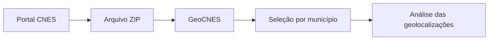

# GeoCNES

**Gestão de geolocalização dos estabelecimentos de saúde**

Visualize, monitore e confira as coordenadas geográficas dos estabelecimentos cadastrados no CNES.

[Sobre](#sobre-o-projeto) • [Funcionalidades](#funcionalidades) • [Como utilizar](#como-utilizar) • [Compatibilidade](#compatibilidade) • [Referências](#referências)

---

## Sobre o projeto

O **GeoCNES** é uma ferramenta desenvolvida para auxiliar os gestores do Cadastro Nacional de Estabelecimentos de Saúde (CNES) de todo o Brasil no gerenciamento das informações de geolocalização dos estabelecimentos sob sua responsabilidade.

A aplicação permite importar os dados disponibilizados pelo CNES e visualizar as coordenadas geográficas dos estabelecimentos em um mapa interativo, facilitando a identificação de registros sem geolocalização e a conferência das coordenadas existentes.

## Contexto e motivação

Conforme a Portaria nº 359, de 15 de março de 2019, da Secretaria de Atenção à Saúde, os estabelecimentos de saúde devem possuir informações de geolocalização em seu cadastro.

O GeoCNES foi desenvolvido para apoiar os gestores nesse processo, facilitando o acompanhamento da qualidade das informações geográficas cadastradas.

## Funcionalidades

| Recurso | Descrição |
| --- | --- |
| Importação de dados | Carregamento de arquivos `.zip` extraídos do portal do CNES. |
| Seleção por município | Seleção dos estabelecimentos de saúde do município de interesse. |
| Mapa interativo | Visualização geográfica dos estabelecimentos cadastrados. |
| Monitoramento cadastral | Identificação de estabelecimentos sem informações de geolocalização. |
| Conferência de coordenadas | Apoio à verificação da exatidão das localizações cadastradas. |

## Como utilizar

1. Acesse o [portal de extração de estabelecimentos do CNES](http://cnes.datasus.gov.br/pages/estabelecimentos/extracao.jsp).
2. Extraia os dados dos estabelecimentos referentes à competência atual.
3. Baixe o arquivo disponibilizado em formato `.zip`.
4. Acesse o [GeoCNES](https://geocnes.dimonconsultoria.com.br).
5. Carregue o arquivo `.zip` na aplicação.
6. Selecione os estabelecimentos do seu município.
7. Visualize as localizações no mapa e confira as informações geográficas cadastradas.

## Compatibilidade

> [!IMPORTANT]
> O GeoCNES é compatível somente com arquivos de dados dos estabelecimentos referentes à **competência atual** do CNES, pois são esses os arquivos que incluem as informações de geolocalização necessárias à aplicação.

Não é necessário descompactar o arquivo antes de carregá-lo na ferramenta.

## Público-alvo

- Gestores municipais do CNES;
- Profissionais responsáveis pela manutenção dos cadastros de estabelecimentos de saúde;
- Equipes de gestão da informação em saúde.

## Escopo da ferramenta

O GeoCNES atua como ferramenta de apoio à visualização e à conferência das informações cadastrais. A visualização das coordenadas não constitui, por si só, uma certificação de sua exatidão.

## Referências

- [Cadastro Nacional de Estabelecimentos de Saúde — CNES](https://cnes.datasus.gov.br/)
- [Portal de extração de dados dos estabelecimentos](http://cnes.datasus.gov.br/pages/estabelecimentos/extracao.jsp)
- Portaria nº 359, de 15 de março de 2019 — Secretaria de Atenção à Saúde.

---

**GeoCNES** · Tecnologia a serviço da gestão da informação em saúde.

[geocnes.dimonconsultoria.com.br](https://geocnes.dimonconsultoria.com.br)

